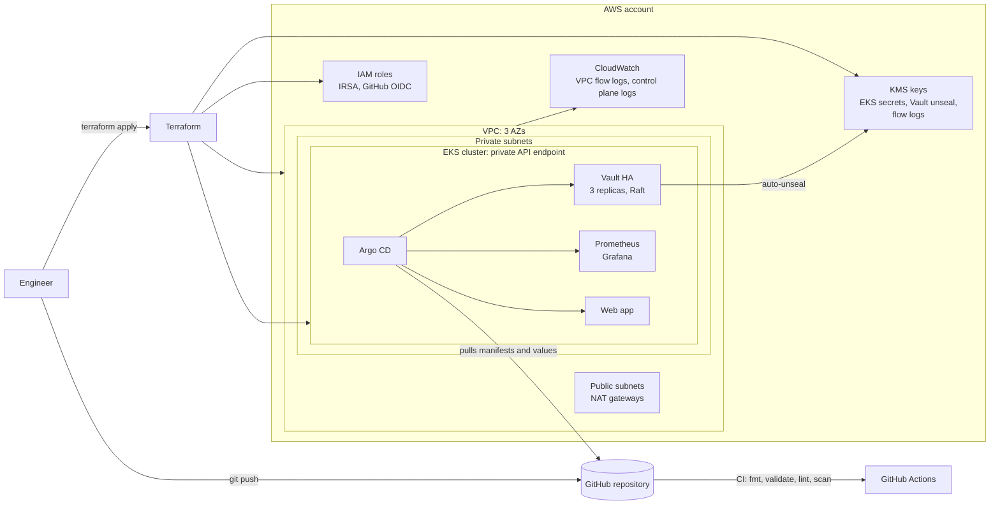

# Production-Ready EKS Cluster with GitOps

Infrastructure as code and GitOps configuration for a Kubernetes platform on AWS EKS.

- **Terraform** builds the AWS layer: a three-AZ VPC, a private EKS cluster and the IAM roles for workloads and CI.
- **Argo CD** deploys the platform services from this repository with the app-of-apps pattern.
- **HashiCorp Vault** runs in HA mode with Raft storage and AWS KMS auto-unseal on EKS.
- **Prometheus and Grafana** give metrics and dashboards. A sample web application shows the Helm chart pattern.

The same Argo CD applications also run on Minikube for local development.

## Quick start

Choose one path:

- **AWS EKS**: create the VPC, cluster and IAM roles with Terraform, then install Argo CD and let it deploy Vault, monitoring and the web app. Follow [Deploy to AWS EKS](#deploy-to-aws-eks), or run `make deploy-aws` from a host that can reach the VPC.
- **Local**: no AWS account needed. Run the commands below, then follow the script output for the Argo CD, Grafana and Vault URLs and credentials. Details are in [Local option: Minikube](#local-option-minikube).

```bash
git clone https://github.com/humzamalak/Production-Ready-EKS-Cluster-with-GitOps.git
cd Production-Ready-EKS-Cluster-with-GitOps
minikube start --cpus=4 --memory=8192 --disk-size=20g
./scripts/setup-minikube.sh
```

## Architecture



## What the code provisions

### AWS layer (Terraform)

Root module: [`terraform/environments/aws`](terraform/environments/aws). Modules: [`terraform/modules`](terraform/modules).

| Module | Resources |
|--------|-----------|
| [`vpc`](terraform/modules/vpc) | VPC, 3 public and 3 private subnets, internet gateway, one NAT gateway per AZ, security groups, VPC flow logs to CloudWatch encrypted with KMS |
| [`eks`](terraform/modules/eks) | EKS cluster with private API endpoint only, secrets envelope encryption with KMS, control plane logging, managed node group (2 to 10 `t3.medium` nodes), add-ons (VPC CNI, CoreDNS, kube-proxy, EBS CSI, Pod Identity Agent), Cluster Autoscaler |
| [`iam`](terraform/modules/iam) | IRSA roles (EBS CSI, Load Balancer Controller, Fluent Bit, Vault), GitHub Actions OIDC role, VPC flow logs role, KMS key and role for Vault auto-unseal |

State uses an S3 backend with DynamoDB locking. You supply the bucket and table at `terraform init`.

### Platform layer (Argo CD)

| Path | Contents |
|------|----------|
| [`argo-apps/install`](argo-apps/install) | Namespaces with Pod Security Standards labels and the bootstrap applications |
| [`argo-apps/projects`](argo-apps/projects) | `prod-apps` AppProject that limits source repositories and destinations |
| [`argo-apps/apps`](argo-apps/apps) | Applications for Vault, Prometheus (kube-prometheus-stack), Grafana and the web app, ordered with sync waves |
| [`helm-charts`](helm-charts) | Values for the upstream charts (`values.yaml`, `values-aws.yaml`, `values-minikube.yaml`) and a custom `web-app` chart |

The `web-app` chart includes a Deployment, Service, HorizontalPodAutoscaler, NetworkPolicy, ServiceMonitor and optional Vault Agent injection.

## Deploy to AWS EKS

### Prerequisites

- AWS account and credentials with permission to create VPC, EKS, IAM and KMS resources
- Terraform 1.5 or later, AWS CLI v2, kubectl 1.33, Helm 3
- An S3 bucket and a DynamoDB table for Terraform state
- Network access to the VPC (VPN, bastion host or AWS Cloud9). The EKS API endpoint is private, so `kubectl` and the Terraform Kubernetes and Helm providers must run from inside the VPC.

### 1. Provision the infrastructure

```bash
cd terraform/environments/aws
cp terraform.tfvars.example terraform.tfvars   # set project_prefix, environment, aws_region

terraform init \
  -backend-config="bucket=<state-bucket>" \
  -backend-config="key=eks-gitops/terraform.tfstate" \
  -backend-config="region=eu-west-1" \
  -backend-config="dynamodb_table=<lock-table>"
terraform plan -out=tfplan
terraform apply tfplan
```

### 2. Connect to the cluster

```bash
aws eks update-kubeconfig \
  --region eu-west-1 \
  --name "$(terraform output -raw eks_cluster_name)"
```

### 3. Select the AWS values

Each Argo CD application lists its environment value files. Before you bootstrap, edit the files in `argo-apps/apps/` so that they use `values-aws.yaml` and not `values-minikube.yaml`. In `helm-charts/vault/values-aws.yaml`, set the service account annotation to the `vault_server_role_arn` Terraform output.

### 4. Install Argo CD and bootstrap the applications

```bash
cd ../../..
kubectl apply -f argo-apps/install/01-namespaces.yaml
kubectl apply -n argocd -f https://raw.githubusercontent.com/argoproj/argo-cd/v3.1.0/manifests/install.yaml
kubectl wait --for=condition=available deployment/argocd-server -n argocd --timeout=300s
kubectl apply -f argo-apps/install/03-bootstrap.yaml
```

`03-bootstrap.yaml` creates two Argo CD applications: one syncs `argo-apps/projects`, and a root application syncs every application in `argo-apps/apps`.

### 5. Initialise Vault

```bash
kubectl exec -n vault vault-0 -- vault operator init
```

With KMS auto-unseal, Vault returns recovery keys, not unseal keys. The pods unseal themselves after restarts.

`scripts/setup-aws.sh` and `make deploy-aws` run the same steps in one command. The full guide is [docs/aws-deployment.md](docs/aws-deployment.md). For Vault on AWS, see [docs/vault-setup.md](docs/vault-setup.md).

## Local option: Minikube

Use Minikube to test the Argo CD applications and Helm values without an AWS account. The default value files in `argo-apps/apps/` target Minikube.

| | AWS EKS | Minikube |
|---|---|---|
| Cluster | Multi-AZ, private endpoint, managed node group | Single node |
| Vault | 3 replicas, Raft storage, KMS auto-unseal | 1 replica, file storage, manual unseal |
| Storage | EBS `gp3` | `standard` StorageClass |
| Cost | AWS charges apply | Free |

```bash
minikube start --cpus=4 --memory=8192 --disk-size=20g
./scripts/setup-minikube.sh
```

The full guide is [docs/local-deployment.md](docs/local-deployment.md). For manual unseal, see [docs/vault-local-setup.md](docs/vault-local-setup.md).

## CI

| Workflow | Trigger | Checks |
|----------|---------|--------|
| [`ci.yaml`](.github/workflows/ci.yaml) | Push to `main`, pull requests | `terraform fmt`, `terraform validate`, yamllint, markdownlint |
| [`validate.yaml`](.github/workflows/validate.yaml) | Push, pull requests | YAML syntax, `helm lint`, Terraform validate, kubeconform on Argo CD manifests, `bash -n` and ShellCheck |
| [`docs-lint.yaml`](.github/workflows/docs-lint.yaml) | Push, pull requests | Markdown lint, link check, required docs |
| [`security-scan.yaml`](.github/workflows/security-scan.yaml) | Push, pull requests, weekly | Trivy config scan (SARIF to the Security tab), tfsec, Checkov, kubesec |
| [`image-scan.yml`](.github/workflows/image-scan.yml) | Push, pull requests | Trivy filesystem scan |
| [`secret-scan-dep-check.yml`](.github/workflows/secret-scan-dep-check.yml) | Push, pull requests | TruffleHog secret scan, dependency review on pull requests |
| `terraform-plan`, `terraform-apply`, `terraform-drift-detection`, `deploy-argocd` | Manual (`workflow_dispatch`) | Plan, apply, drift detection and Argo CD sync against a real AWS account |

The security scanners report findings but do not fail the build. The AWS workflows need the `AWS_ACCESS_KEY_ID`, `AWS_SECRET_ACCESS_KEY`, `TF_STATE_BUCKET` and `TF_STATE_LOCK_TABLE` secrets. See [docs/ci_cd_pipeline.md](docs/ci_cd_pipeline.md).

## Repository layout

```text
argo-apps/      Argo CD install manifests, projects and applications
helm-charts/    Helm values per environment and the web-app chart
terraform/      AWS root module and VPC, EKS and IAM modules
scripts/        Setup, deploy, validate and Vault helper scripts
docs/           Deployment, architecture, Vault and troubleshooting guides
docs/history/   Earlier audit and upgrade reports
```

## Versions

Kubernetes 1.33, Argo CD 3.1.0, Terraform 1.5 or later, AWS provider 5.0 or later. See [VERSION](VERSION) and [docs/K8S_VERSION_POLICY.md](docs/K8S_VERSION_POLICY.md).

## Licence

MIT. See [LICENSE](LICENSE).
